# 你只活一次 · You Only Live Once

> 记住你终有一死——然后，真正地活。

一个**以终为始的任务旅程**：先把路看清，再把时间投进去，最后让每一步都留下痕迹。

当前进度：**Linux x64 ✅ 已交付 · Windows x64 ✅ 源码与便携版已生成 · Android ✅ 源码 + Debug APK 已生成**（Windows/Android 待实机验收）。

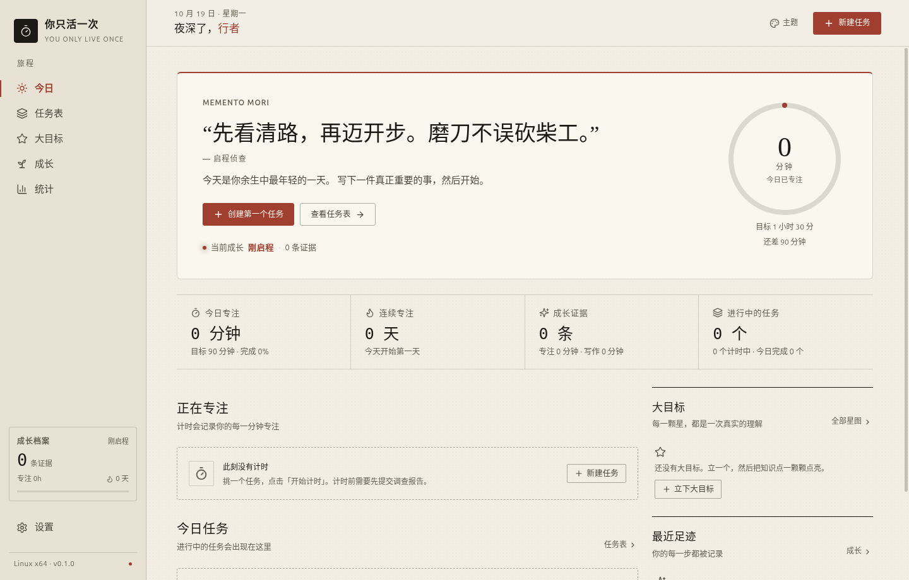

> 首次进入是一张白纸：没有预置任务、大目标、阶段、专注记录或证据。示例旅程只保留在设置里的手动入口。

> 下方除空状态外的功能截图，使用手动载入的示例数据，仅用于展示界面与功能。

---

## 为什么做这个

人生不能重来，时间也不会回头。市面上很多待办工具只负责“记录要做的事”，却回避了两个更关键的问题：

1. **这件事到底要花多久？** 小白最容易被“学完就会了”骗到，然后在无效努力里消耗数月。
2. **现在投入的时间，真的有用吗？** 不先想清楚学什么、不学什么，勤奋就只是战术上的安慰。

所以「你只活一次」做了三件不太一样的事：

- **启程侦查（调查报告）是硬门禁**：任何任务第一次开始计时前，必须写清楚对象、目标、验收标准、学习路径、资料、取舍边界、风险与时间估计。报告会实时评分，学习路径可一键沉淀为任务阶段。
- **时间必须被兑现**：每个任务都有预计投入与实际投入，统计页持续对比「预计 vs 实际」，让时间感越来越准。
- **正反馈是成长证据式的**：专注、报告、阶段、作品、知识点和文档写作都会留下可回看的证据；技能树把能力可视化，成长阶段记录你正在变成谁。

---

## 平台状态

| 子项目 | 平台 | 状态 | 产物 |
| --- | --- | --- | --- |
| `apps/linux` | Linux x64 | ✅ 已交付 | AppImage、deb |
| `apps/windows` | Windows x64 | ✅ 源码 / 打包完成，待 Windows 实机验收 | 便携版 ZIP、`win-unpacked`；NSIS 需 Windows/Wine |
| `apps/android` | Android 手机 | ✅ 源码 / APK 构建通过，待真机验收 | Debug APK；后台前台服务待接入 |

三端共用 `packages/core`（领域规则）与 `packages/desktop-ui`（界面与状态机）。Linux/Windows 替换平台外壳；Android 增加移动布局、Capacitor 外壳与本地存储桥。


---

## 已实现功能

| 需求 | 实现 |
| --- | --- |
| 任务表 | 状态、类型、优先级、难度、预计用时、截止日期、进度、标签、关联大目标 |
| 任务链 | 可设一级/二级/三级任务并关联上一级；列表和详情显示上级任务与链路 |
| 填进度 | 详情抽屉内滑杆 + 阶段进度同步；到 100% 自动完成任务 |
| 学习文档 | 每个任务内置 Markdown 编辑器：编写 / 预览 / 全屏分栏，格式工具栏、任务清单、表格、代码块、链接与自动保存 |
| 不同时期拆分 | 阶段支持预计分钟、计划日期、内联编辑、完成勾选；可由调查报告路径自动生成 |
| 预计完成时间 | 任务级预计日期与预计投入；报告提交后用校准值覆盖，并保留「预计 vs 实际」 |
| 点击开始计时 | 任务行 / 今日卡片 / 详情页均可开始；自动进入专注空间 |
| 调查报告门禁 | 11 项必答、实时评分、未提交不能计时；提交后自动开始计时；可修订 |
| 学习路径与取舍 | 路径至少两步且带时间预算；明确「真正要学的」与「明确不学的」 |
| 单计时 | 一次只允许一个计时；开始第二个任务前，必须先收功或继续当前任务 |
| 大目标 + 知识点 | 星图式知识点，可点亮；全部点亮后目标达成并额外奖励 |
| 成长证据 / 技能树 | 每次专注、报告、阶段、任务、知识点和写作都会进入证据链；大目标作为技能树，节点随证据点亮；有成长阶段与里程碑 |
| 学习文档写作计时 | 写 Markdown 时可开始写作计时，关联到某次专注；写作时长独立记录，并作为一条证据归档 |
| AI 学习助理（可选） | 先做多轮背景访谈，再由用户写自己的计划；AI 评估计划合理性与时间，标记明显风险；不出练习题，不代写，不自动改数据 |
| 时间诚实性 | 15s 心跳、收功结算、重启自动暂停；系统休眠/锁屏按断开时刻暂停计时 |
| 统计 | 14 天趋势、热力图、领域分布、预计 vs 实际、时间洞察 |
| 本地优先 | JSON 原子写入、自动备份、导入导出、崩溃恢复；无账号、无后端、无遥测；AI 仅在配置后按需直连 |
| 界面主题 | 纸上时间 / 深墨 / 瑞士网格三套内置主题；设置页可自编辑一套自己的主题，命名（例如「噜噜」）、选底子、调 9 个颜色，顶栏主题按钮会一起循环 |
| 多语言 | 主题按钮旁的语言按钮：中文 / 日本語 / 한국어 / English；切换后记住选择；用户自己写的任务、文档和姓名保持原文，AI 输出按当前语言生成 |
| 整洁界面 | 纸上编辑设计：暖纸、墨色、印章红、细线与留白；焦点模式用深墨色；支持减少动效 |
| 首次引导 | 称呼、每日目标；默认不载入任何示例数据，示例需在设置中手动载入 |

### 界面一览

| 任务表 | 任务详情 |
| --- | --- |
|  | 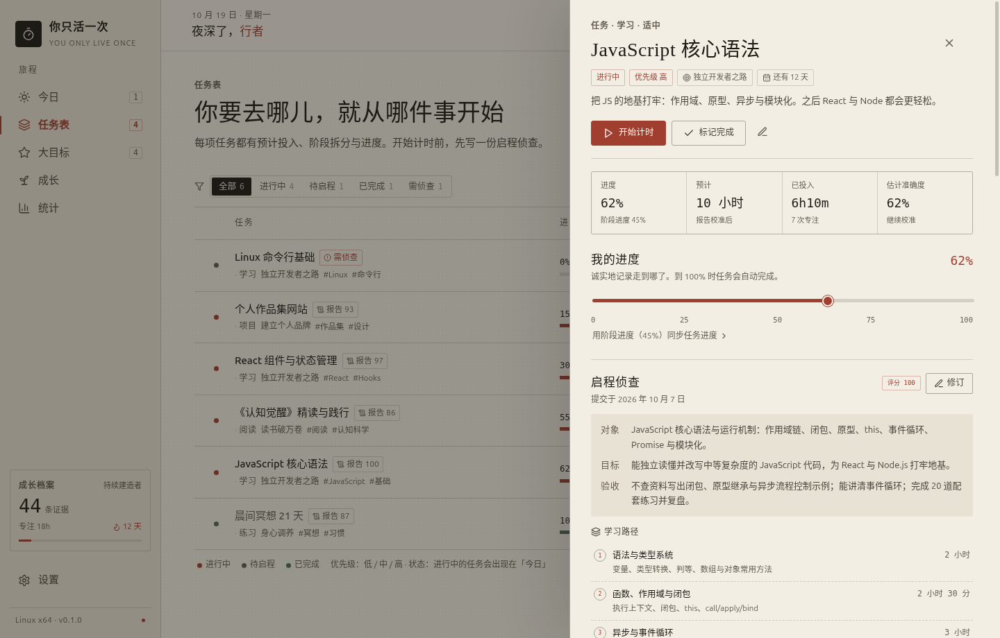 |

| 启程侦查 | 大目标星图 |
| --- | --- |
|  | 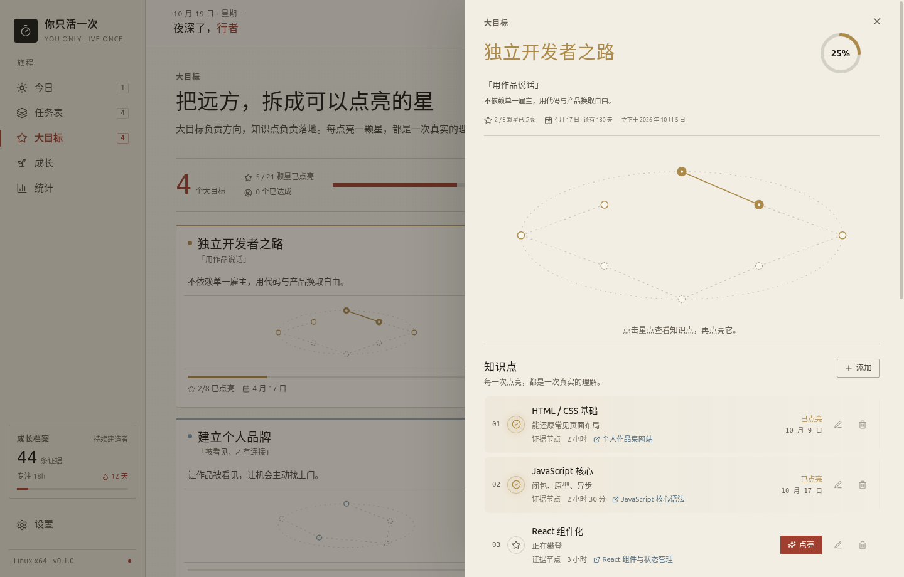 |

| 成长 | 统计 |
| --- | --- |
|  |  |

| 专注空间 | 首次引导 |
| --- | --- |
|  |  |

| 阶段编辑 | 单计时守卫 |
| --- | --- |
| 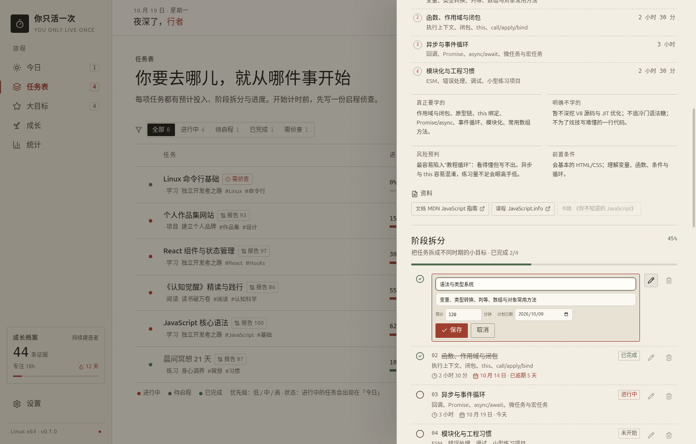 | 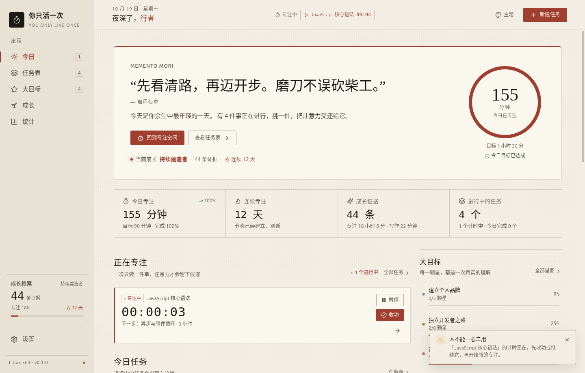 |

| 证据印章 | 学习文档写作计时 |
| --- | --- |
| 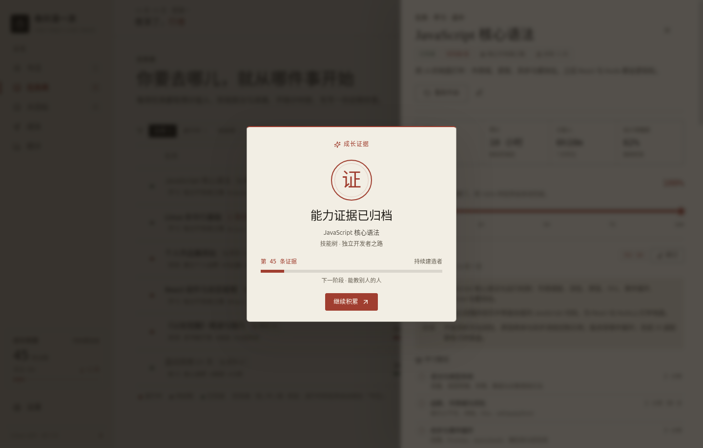 |  |

| AI 学习助理设置 | AI 计划评估 |
| --- | --- |
| 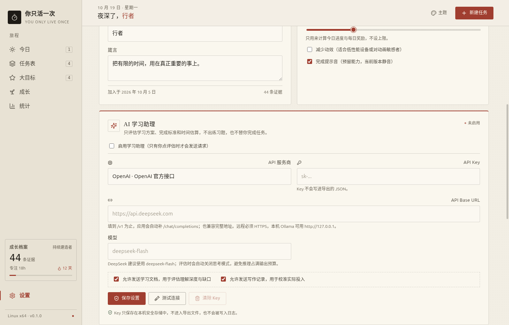 | 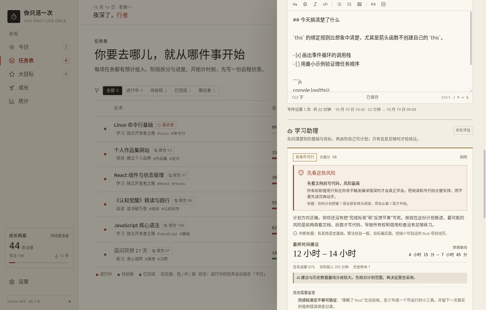 |

| English | 日本語 / 한국어 |
| --- | --- |
|  | 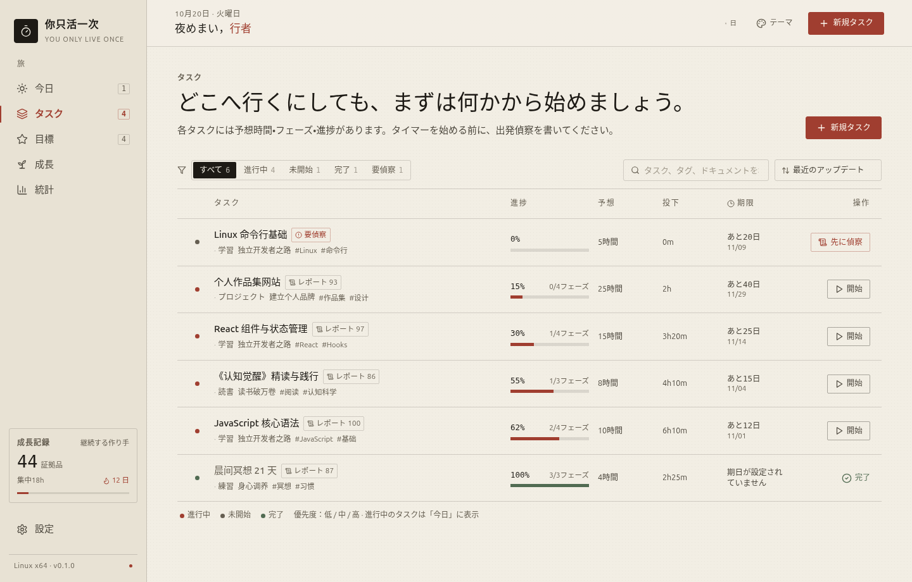 |

| 英文启程侦查 | 英文成长 / 统计 |
| --- | --- |
| 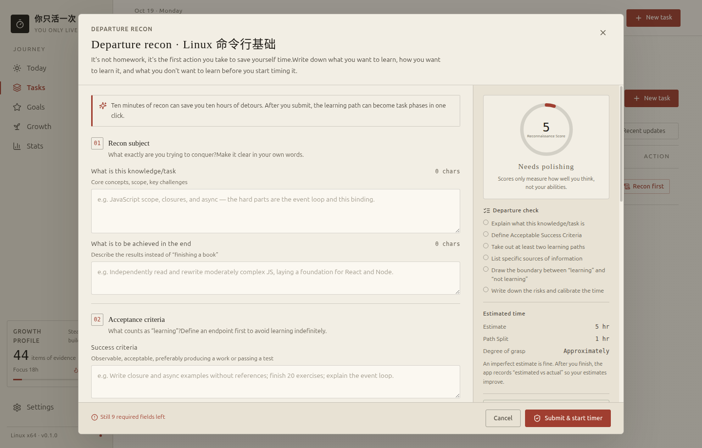 | 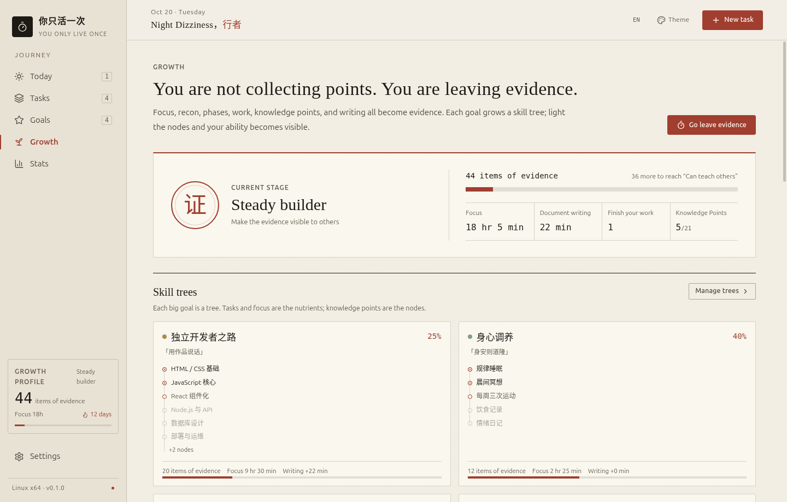 |
|  | 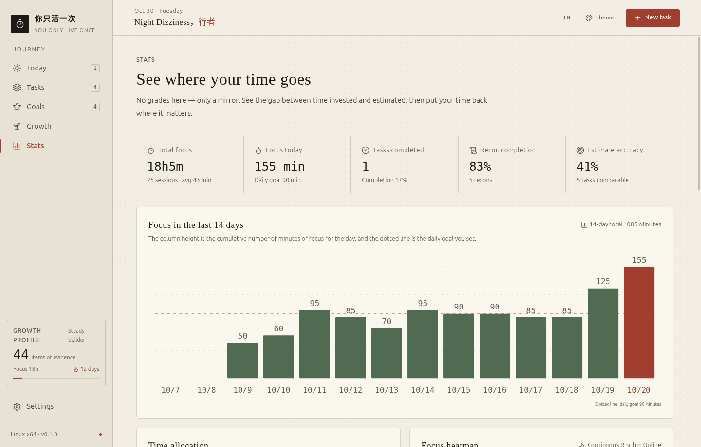 |

| 自编辑主题 | 应用「噜噜」主题 |
| --- | --- |
|  | 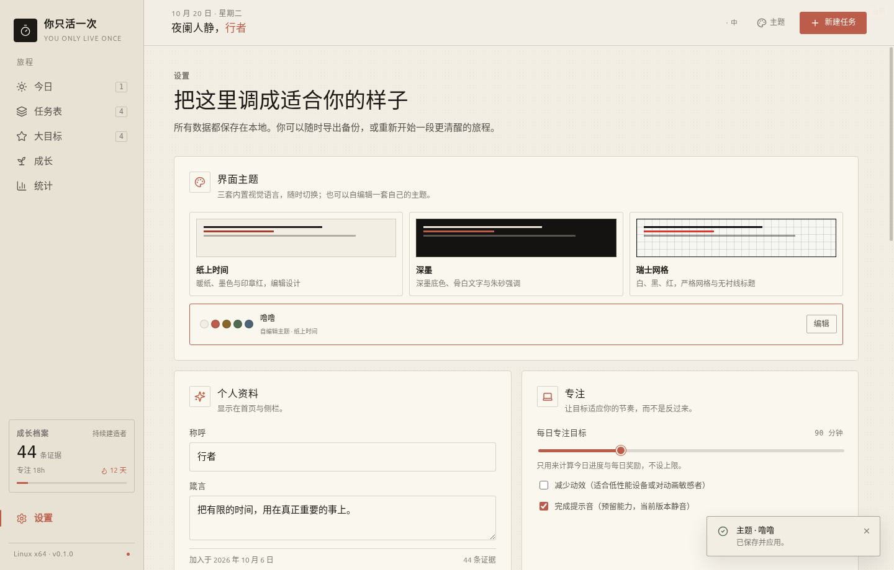 |

| 深墨主题 | 瑞士网格主题 |
| --- | --- |
| 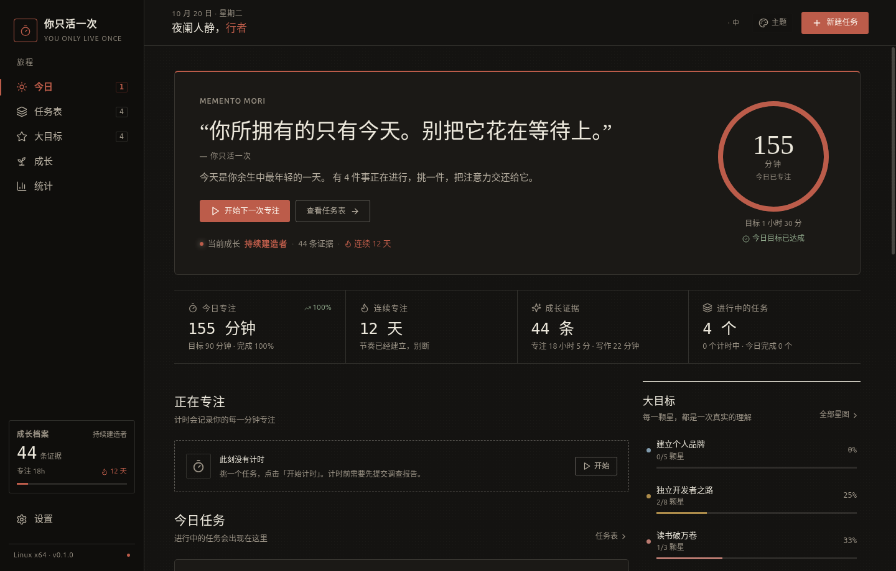 | 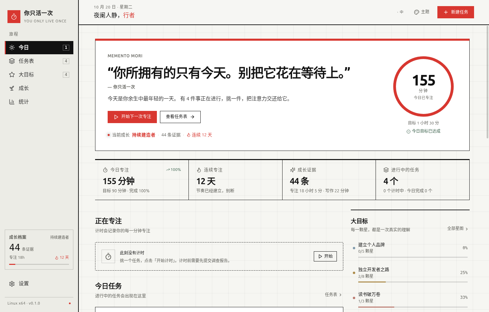 |

| 移动今日 | 移动任务 |
| --- | --- |
|  | 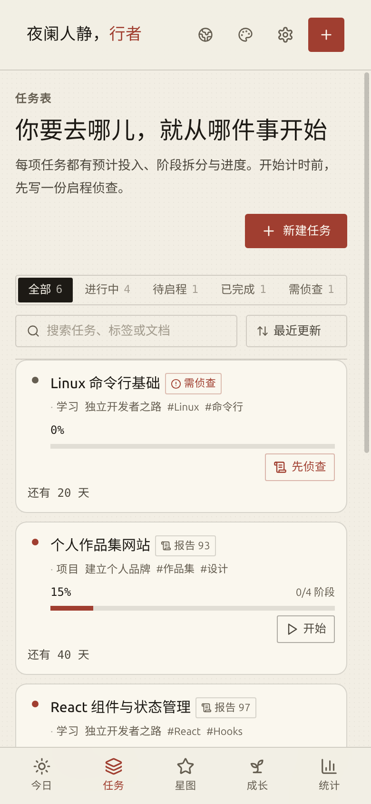 |

| 移动专注 | 移动星图 |
| --- | --- |
| 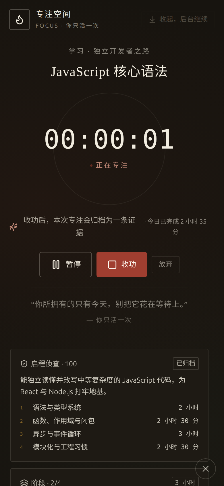 | 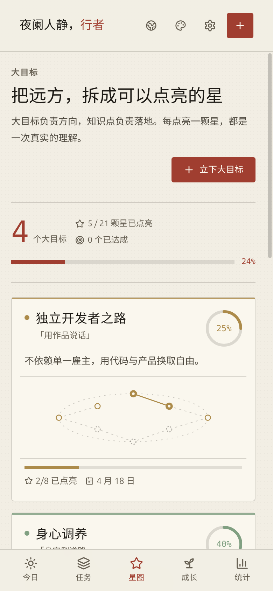 |

### 成长证据怎么运作

- **证据链**：每次专注、每次文档写作、提交报告、完成阶段、完成任务、点亮知识点、完成技能树，都会生成一条带时间和技能的成长证据。
- **技能树**：每个大目标就是一棵技能树；知识点是节点，任务、专注与写作是养料。节点点亮后不会熄灭。
- **成长阶段**：从「刚启程」到「长期主义者」，阶段由证据数量推进；不靠随机掉落，也不会因为一次失误倒退。
- **即时反馈**：完成重要动作会盖下「证」印章，显示第几条证据、所属技能树和下一阶段；日常动作以证据 toast 归档。
- **学习文档写作计时**：选择关联到某次专注，停笔后记录写作时长；写作会作为证据归档，并显示在对应专注记录旁。
- 这是学习反馈，不涉及真实货币、抽卡或赌博。

### AI 学习助理怎么运作

- **默认关闭**。只有你在设置中启用，并点击「评估」时才会发出请求。
- 用户自己选择服务商，填写 **API Key → API Base URL → 模型**。支持任何 OpenAI-compatible 接口：OpenAI、DeepSeek、Moonshot、本地 Ollama，以及自定义地址。
- **API Base URL 是 `base_url`**，例如 DeepSeek 官方文档给出的 `https://api.deepseek.com`；应用会自动请求 `/chat/completions`。直接填完整地址也兼容。
- **DeepSeek**：官方当前模型为 `deepseek-flash` / `deepseek-v4-pro`。`deepseek-flash` 默认开启思考模式；应用在评估时会发送 `thinking: { "type": "disabled" }` 和 `reasoning_effort: "none"`，避免推理 token 占满 `max_tokens` 导致 content 为空。参考 [DeepSeek API 文档](https://api-docs.deepseek.com/zh-cn/)。
- **多轮背景访谈**：AI 根据任务动态提问（例如先学过哪些语言、算法基础、做过的具体项目、目标水平），**每轮只问一个**；不会使用固定题库，也不会问每天/每周能学几小时。
- **内部置信度门槛**：访谈会持续多轮，只有内部置信度达到阈值才进入下一步；不到阈值就不输出最终判断。置信度不在界面展示，避免影响回答。
- **用户先写计划**：达到阈值后，用户先自己写清顺序、时间和完成标准；AI 只评价，不替用户写。
- **计划评估**：AI 判断计划是否合理，结合当前进度、已投入时间、访谈中暴露的基础和历史时间偏差，给出时间区间、计划结论、风险和醒目 tips。
- **防无效回答**：每轮只问一个问题，问题下方不附解释；回答答非所问、过于空泛或与目标矛盾时，不会增加内部置信度，并会换一种方式追问同一主题。
- **确定性基线**：代码先算历史偏差中位数和可用区间，AI 负责解释和判断；两者差距过大时 UI 会明确提示。
- **只评估，不改数据**：报告可以「采用中值」写回预计时间，也可以忽略；不会自动改任务、不会自动完成任务。
- **可回看**：访谈问答、用户计划、内部置信度和最终结论会保存在本机的评估会话中；置信度不展示在界面。
- **不做练习题、不刷掌握度**：目前没有题库、判分和复习队列，避免用聊天或出题制造假进度。
- **Key 安全**：桌面优先使用系统钥匙串，Android 使用 Keystore；Key 不进入导出的 JSON，也不写入日志。没有系统钥匙串时会明确标记为仅本地保存。
- **上下文权限**：学习文档和写作记录默认允许发送，可在设置中关闭；每次只发送当前任务。

---

## 快速开始

### 环境

- Node.js ≥ 20.19（仓库在 Node 24 下构建；Vite 7 要求）
- npm ≥ 10
- Linux x64、Windows x64 或 Android 手机
- 移动端构建需要 JDK 21 + Android SDK 35（见 `apps/android/README.md`）

### 安装

```bash
cd you-only-live-once
npm install
```

### Linux

```bash
npm run dev             # 开发模式（Vite + Electron）
npm start               # 生产构建并启动
npm run start:demo      # 载入示例数据启动
```

### Windows

```bash
npm run dev:windows          # 开发模式
npm run start:windows        # 构建并启动
npm run start:demo:windows   # 载入示例数据启动
```

### Android

```bash
npm run dev:android          # Vite 移动 Web 预览（浏览器/模拟器调试）
npm run build:android        # 构建 Web 资源
npm run sync:android         # 构建并同步到 android/ 原生工程
npm run package:android      # Gradle assembleDebug + 复制 APK
```

首次构建 Android 需要先按 `apps/android/README.md` 安装 JDK 21 与 Android SDK 35。
APK 产物位于 `apps/android/release/YouOnlyLiveOnce-0.1.0-android-debug.apk`。

本机若没有为 `chrome-sandbox` 配置 setuid，Linux 启动器会自动附加
`--no-sandbox`（仅开发环境）；Windows 原生启动不需要该参数。

### 验证与测试

```bash
npm run verify                # 类型检查 + core 单测 + Linux/Windows/Android 构建
npm run test:ui               # Linux 真实 UI 交互回归
npm run test:ai               # 本地 mock API：单问题访谈、无效回答降权、用户计划评估与写回
npm run test:language         # 中文 / 日本語 / 한국어 / English 切换与重启保留
npm run test:theme-editor     # 自编辑主题：命名、改色、应用、重启保留
npm run test:rewards          # 奖励去重 + 成长技能树验证
npm run test:themes           # 三主题切换、设置面板与重启恢复
npm run verify:windows:preview # 验证 Windows 外壳与共享 UI 启动
npm run test:mobile           # 390×844 移动视口逐页截图
npm run verify:android:web    # 验证 Android Web 包、平台桥与 localStorage 持久化
npm run screenshots           # Linux 逐页截图验收
```

覆盖的关键断言：

- 无报告任务点击「开始」只会打开调查报告，不会开始计时
- 完整报告后自动进入专注空间；收功后写入会话、任务投入与证据链
- 开始第二个任务计时时被拦截，只能保留一个活跃计时
- 知识点点亮后写入目标，重启仍存在
- 关闭应用后重开：计时自动暂停、任务与证据不丢失、不虚增专注时间
- 无示例引导 → 创建第一个任务 → 数据落盘
- 阶段撤销/重做、任务重开再完成都不重复领奖
- Windows 外壳能加载共享 UI、写入 `yolo-windows` 数据目录并渲染示例数据
- Android 平台桥能把数据写入 localStorage/Preferences，计时收功能追加会话
- Android 底部导航、390×844 布局与全宽报告/详情页无横向溢出

---

## 打包

### Linux

```bash
npm run package:linux
# apps/linux/release/YouOnlyLiveOnce-0.1.0-x86_64.AppImage  （约 120 MB）
# apps/linux/release/YouOnlyLiveOnce-0.1.0-amd64.deb        （约 96 MB）
```

### Windows

```bash
npm run package:windows
# apps/windows/release/win-unpacked/
# apps/windows/release/YouOnlyLiveOnce-0.1.0-win-x64-portable.zip  （约 152 MB）
```

便携版解压后运行 `yolo.exe` 即可。当前环境没有 Wine，**NSIS 安装包**需要在 Windows 本机或
装有 Wine 的 CI 上执行：

```bash
npm run package:windows:installer
```

Windows 可执行文件已写入图标与产品元数据，但未做代码签名，SmartScreen 可能提示未知发布者。

### Android

```bash
npm run package:android
# apps/android/release/YouOnlyLiveOnce-0.1.0-android-debug.apk （约 5 MB）
```

当前为 **debug 签名**，可直接安装到测试设备；上架 Google Play 需要 release keystore 与签名配置。
APK 已通过 `aapt2` 校验：包名 `com.yolo.android`、版本 `0.1.0`、minSdk 23、targetSdk 35、中文应用名与自适应图标。

发布产物的 SHA256 校验值见根目录 `SHA256SUMS.txt`。

### 数据位置

```text
Linux:   $XDG_CONFIG_HOME/yolo-linux/yolo-data.json
Windows: %APPDATA%\yolo-windows\yolo-data.json
Android: Capacitor Preferences（应用私有存储，键 yolo-data-v1）
```

默认即 Linux `~/.config/yolo-linux/`。桌面端每次保存前会写入 `yolo-data.backup.json`；Android 使用 Preferences 备份键。设置页提供导出/导入。
三端 JSON 模型一致，备份可以互相导入。

---

## 使用流程

1. **首次进入**：设置称呼与每日专注目标。首次进入没有任何预填任务、大目标、阶段或专注记录；需要示例时可在设置中手动载入。
2. **立任务**：写下任务、预计投入、截止日期与关联目标；需要时选择任务层级并关联上级任务，形成任务链。
3. **写报告**：点击「开始计时」触发启程侦查。填完 11 项后提交；学习路径可选择写入阶段。
4. **专注**：进入专注空间，可暂停/收功；一次只允许一个计时，开始新任务前先收功当前任务。
5. **推进**：在详情里拖动进度、勾选/编辑阶段；用 Markdown 学习文档记录概念、代码与卡点；阶段全部完成时提示收尾。
6. **完成**：任务完成归档为能力证据；预计时间准确还有额外奖励。
7. **点亮**：进入大目标星图，把知识点一个个点亮；全部点亮即目标达成。
8. **回看**：统计页看 14 天趋势、热力图、时间去向与预估偏差。

### 学习文档

任务详情中的「学习文档」是一个本地 Markdown 编辑器：

- 编写 / 预览切换；桌面端可展开为全屏并开启左右分栏。
- 工具栏支持二级标题、粗体、斜体、行内代码、列表、任务清单、引用、链接、代码块。
- `Ctrl / ⌘ + B`、`Ctrl / ⌘ + I`、`Ctrl / ⌘ + K`、`Ctrl / ⌘ + S` 快捷键；`Tab` 插入缩进。
- 停顿 1 秒自动保存，关闭抽屉时也会静默保存；内容仍写入任务的 `note` 字段，旧数据无需迁移。
- 预览使用 `marked` 解析并由 DOMPurify 清洗，链接交给系统浏览器打开。


---

## 项目结构

```text
you-only-live-once/
├─ packages/
│  ├─ core/                 # 跨平台领域核心（纯 TS，无 UI/平台依赖）
│  │  ├─ src/types.ts       # 任务/阶段/报告/目标/计时/奖励模型
│  │  ├─ src/report.ts      # 报告校验、评分、路径→阶段
│  │  ├─ src/rewards.ts     # 成长值、成就、结算
│  │  ├─ src/growth.ts      # 证据链、成长阶段、技能统计
│  │  ├─ src/estimate.ts    # 时间评估基线、历史校准
│  │  ├─ src/timers.ts      # 计时、心跳、崩溃恢复
│  │  ├─ src/stats.ts       # 趋势、预估校准
│  │  ├─ test/core.test.ts  # 领域单元测试
│  │  ├─ test/growth.test.ts # 证据链、阶段与技能统计
│  │  └─ test/estimate.test.ts # 时间基线、迁移
│  └─ desktop-ui/           # 三端共享界面与状态机（含移动布局）
│     ├─ src/lib/ai.ts       # OpenAI-compatible 客户端、提示词、JSON 校验
│     ├─ src/lib/i18n.ts     # 界面语言运行时与动态文案
│     ├─ src/lib/translations.json # 中文源文案 → 英/日/韩
│     └─ src/               # 6 个页面、弹窗、抽屉、图表、zustand store
├─ apps/
│  ├─ linux/                # ✅ Linux x64 外壳（Electron 44）
│  ├─ windows/              # ✅ Windows x64 外壳 + 打包配置
│  └─ android/              # ✅ Android 手机版（Capacitor + 移动布局 + 存储桥）
├─ docs/
│  ├─ architecture.md       # 分层、数据流、计时恢复、奖励结算
│  └─ roadmap.md            # 三平台路线与验收标准
├─ scripts/
│  ├─ screenshot.mjs        # Linux 截图验收
│  ├─ interaction-test.mjs  # Linux 真实 UI 交互回归
│  ├─ verify-rewards.mjs    # 奖励去重与升级界面验证
│  ├─ verify-packaged.mjs   # Linux 解包产物启动验证
│  ├─ verify-appimage.mjs   # AppImage 启动验证
│  ├─ verify-windows-preview.mjs # Windows 外壳/共享 UI 冒烟
│  ├─ mobile-preview.mjs    # 390×844 移动视口截图
│  └─ verify-android-web.mjs # Android 平台桥 / Web 包冒烟
└─ screenshots/             # 验收截图
```

### 技术选型

- **Electron 44**：Linux / Windows 桌面壳成熟，离线运行、本地文件、窗口管理都直接。
- **共享桌面 UI**：`packages/desktop-ui` 携带页面、组件与 zustand 状态机，平台只负责窗口、存储与包装。
- **React 19 + TypeScript + Vite 7**：构建快，渲染层可独立预览。
- **zustand + immer**：状态机清晰，奖励结算与数据变更统一经过 `commit`。
- **Capacitor 7 + 移动布局**：Android 复用 `packages/desktop-ui`，通过底部导航、单列任务卡、全宽抽屉适配手机；平台桥使用 Preferences/Share/Filesystem。
- **纯 TS core**：Android 不需要重复实现报告、计时与奖励规则。
- **本地 JSON**：v1 取舍是简单、可备份、可手工修复；数据量增长后可迁移 SQLite（`migrateData` 已预留版本位）。

---

## 设计取舍

- **刻意的摩擦**：调查报告不是表单收集，而是把「先想清楚」变成不可跳过的动作。它可能让开始变慢，但会让停止变早。
- **不惩罚**：证据只增不减，撤销阶段不会扣分。奖励服务于长期动机，而不是制造焦虑。
- **不卷时长**：统计关注投入与预估偏差，不设排行榜，不做社交比较。
- **本地优先**：没有账号、云同步与埋点。你的时间记录属于你自己。
- **视觉方向**：三套主题共用同一布局与数据——纸上时间（暖纸、墨色、印章红）、深墨（深色底、骨白、朱砂）、瑞士网格（白/黑/红、无衬线粗标题、严格网格）。主界面不用装饰性渐变、发光、玻璃拟态和大圆角；专注模式统一使用深墨色。顶栏「主题」按钮循环切换，设置页也可直选；另外支持自编辑一套主题（命名、底子与 9 个颜色），例如「噜噜」。
- **离线完整**：无外部字体、无 CDN、无网络请求；断网也能完整使用。

---

## 已知限制

- 完成提示音目前为预留开关，尚未接入音频（避免默认打扰）。
- Linux 版在无 setuid sandbox 的开发环境需要 `--no-sandbox`；发行包会按系统正常配置。
- Windows 产物尚未在真实 Windows 10/11 上验收 DPI、IME、睡眠恢复与 NSIS 安装流程。
- Windows 可执行文件未签名；NSIS 安装包需要 Windows/Wine 才能构建。
- Android APK 为 debug 签名，尚未在真机/模拟器上验收；上架需要 release 签名。
- Android 在应用退到后台/锁屏时按真实时间继续计时；尚未接入前台服务与常驻通知，进程被系统回收时会恢复到最后一次心跳。
- 数据文件为单 JSON / Preferences，v1 未加密；敏感信息请勿写入报告。

---

## License

私有项目，未授权分发。`UNLICENSED`。
