# 你只活一次 · You Only Live Once

> 记住你终有一死——然后，真正地活。

一个**本地优先的任务旅程**：先侦查，再专注，最后把投入变成看得见的成长证据。

首次进入是一张白纸，没有预置任务或示例数据；需要示例时可在设置中手动载入。

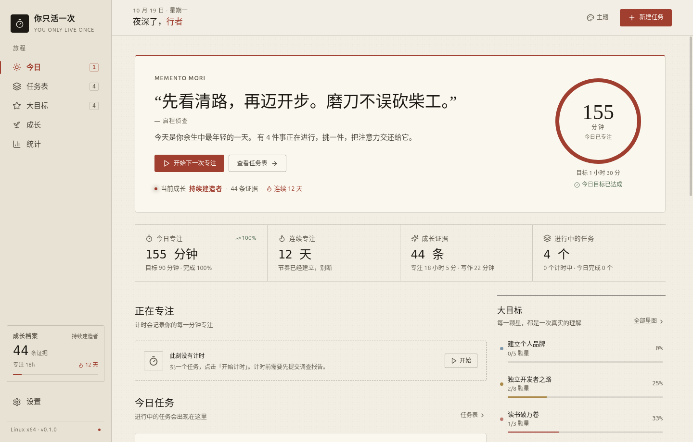

## 平台

| 平台 | 架构 | 产物 |
| --- | --- | --- |
| Linux | x64 / arm64 | AppImage、deb |
| Windows | x64 / arm64 | 便携版 ZIP |
| Android | arm64 / universal | Debug APK |

## 它解决什么

普通待办只记录「要做什么」，却很少回答两个问题：

1. 这件事到底要花多久？
2. 现在投入的时间，真的有用吗？

所以应用的闭环是：

- **先侦查**：任务第一次计时前，写清对象、目标、验收标准、学习路径、资料、取舍、风险和时间估计。
- **再专注**：一次只允许一个计时；开始第二个任务前，必须先收功或继续当前任务。
- **后回看**：预计 vs 实际、专注记录、写作记录、阶段进度和成长证据都会留下。
- **不游戏化时间**：不设排行榜，不惩罚中断；只让证据和阶段缓慢累积。

## 亮点

| 模块 | 说明 |
| --- | --- |
| 任务表 | 状态、类型、优先级、难度、预计/实际投入、截止日期、标签、关联目标 |
| 任务链 | 一级 / 二级 / 三级任务；可关联上级任务，列表与详情显示链 |
| 启程侦查 | 11 项必答、实时评分、学习路径可沉淀为阶段；未提交不能计时 |
| 单计时 | 同时只允许一个计时；第二个任务会被拦截 |
| 学习文档 | 任务内 Markdown 编辑 / 预览 / 全屏分栏 / 自动保存；支持写作计时 |
| 成长证据 | 专注、报告、阶段、作品、知识点、写作都会进入证据链 |
| 技能树 | 大目标即技能树；知识点可点亮，全部点亮后目标达成 |
| 统计 | 14 天趋势、热力图、时间去向、预计 vs 实际、时间洞察 |
| 皮肤 | 纸上时间 / 深墨 / 瑞士网格 / 噜噜；支持亮暗与自编辑主题 |
| 多语言 | 中文 / 日本語 / 한국어 / English；记住选择 |
| 本地优先 | JSON 原子写入、备份、导入导出、崩溃恢复；无账号、无云同步、无遥测 |

## 界面

| 任务表 | 启程侦查 |
| --- | --- |
| 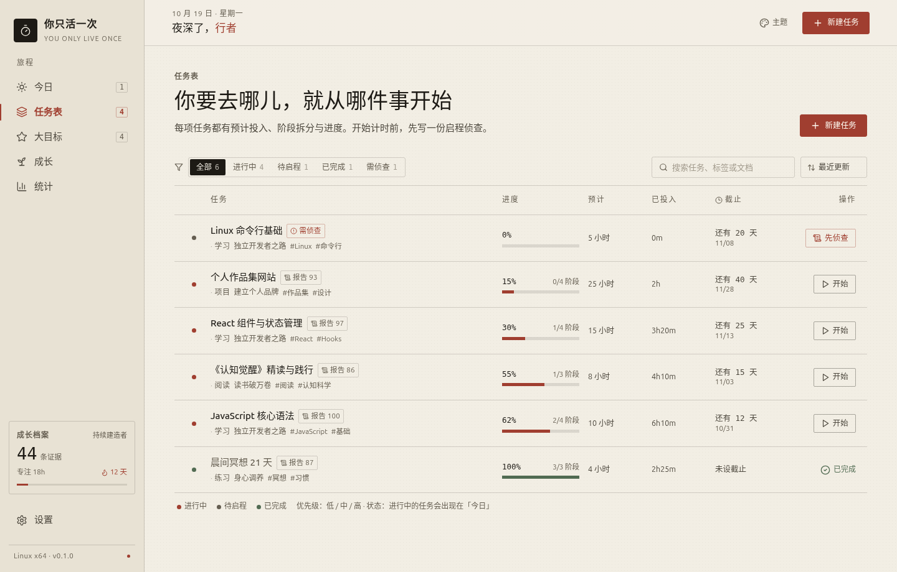 | 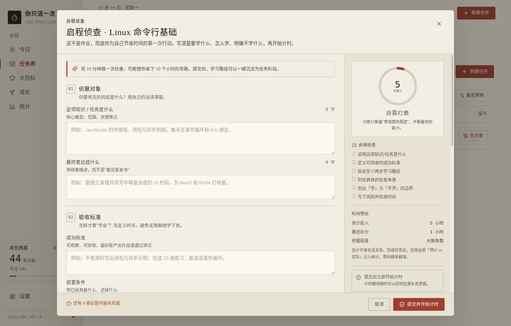 |

| 成长 | 统计 |
| --- | --- |
| 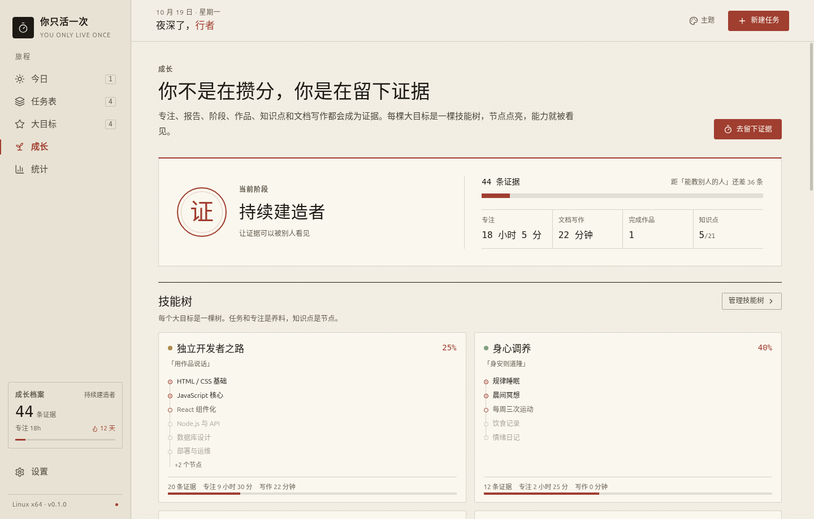 | 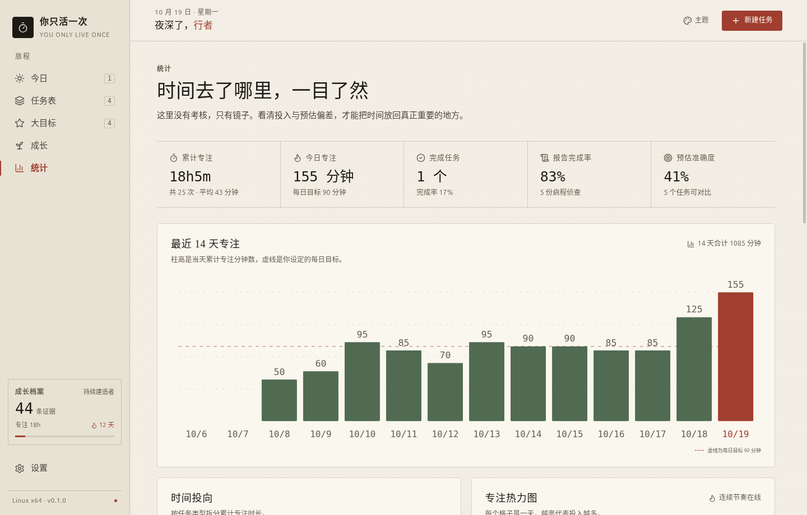 |

| 专注空间 | 学习文档 |
| --- | --- |
| 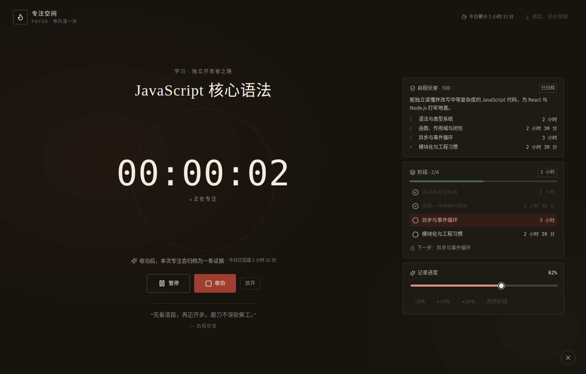 | 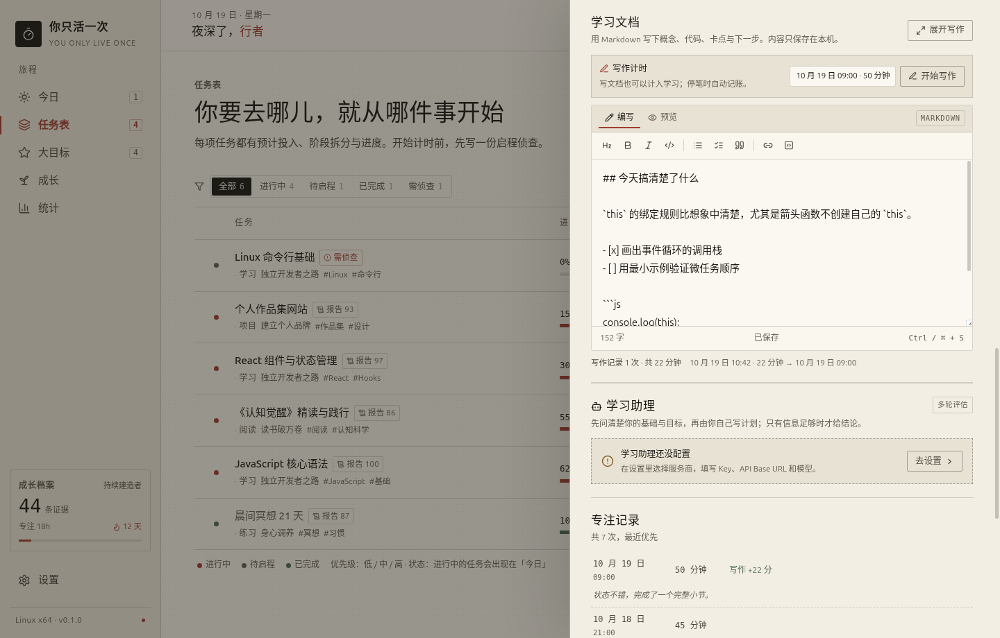 |

| 噜噜 · 亮色 | 噜噜 · 暗色 |
| --- | --- |
| 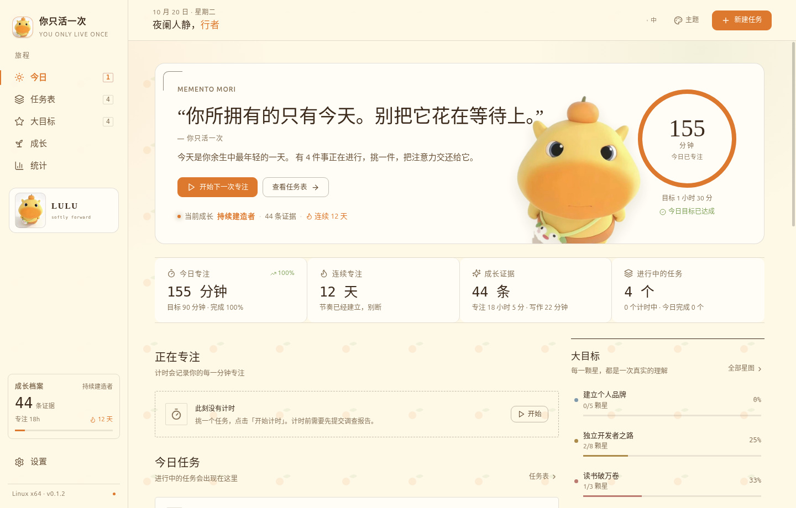 | 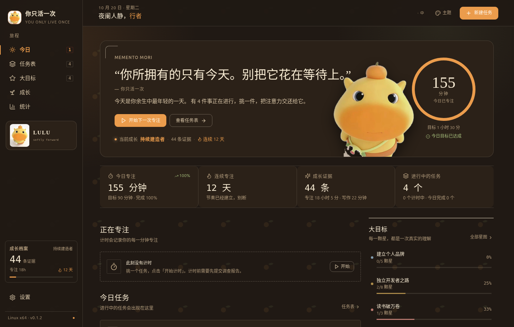 |

| 自编辑主题 | English |
| --- | --- |
| 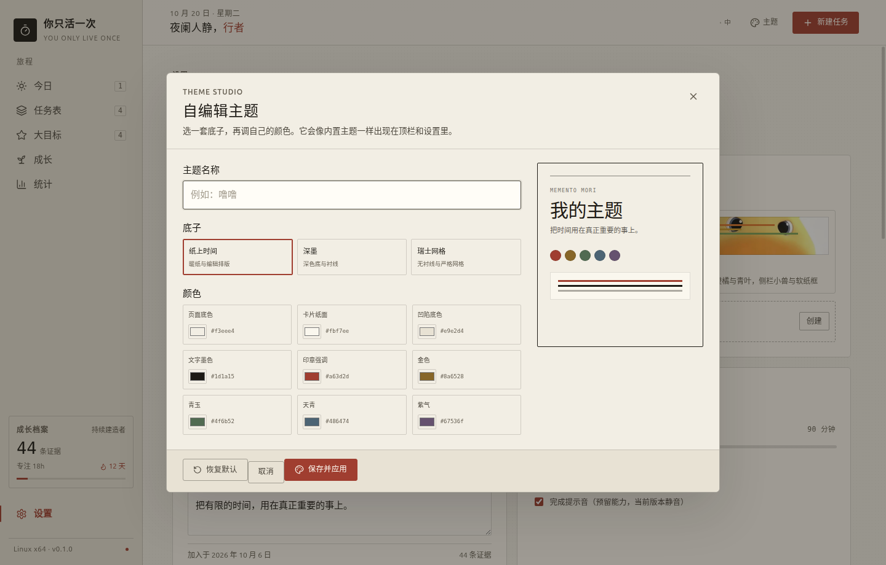 | 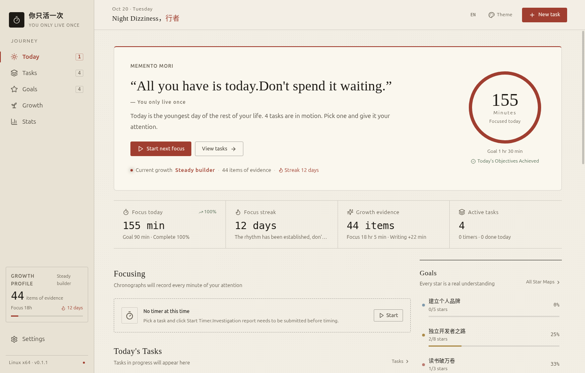 |

## 噜噜皮肤

「噜噜」是项目内置的完整皮肤包，不是单纯换色：

- 奶油黄 / 蜜橘 / 青叶配色
- 首页人物、侧栏 LULU 卡、品牌印章
- 软纸圆角、角落装饰线、果实纹样背景
- 亮色与暗色双版本，设置里即时切换
- 顶栏主题按钮与设置页都可选
- 人物资产位于 `packages/desktop-ui/src/assets/lulu/`

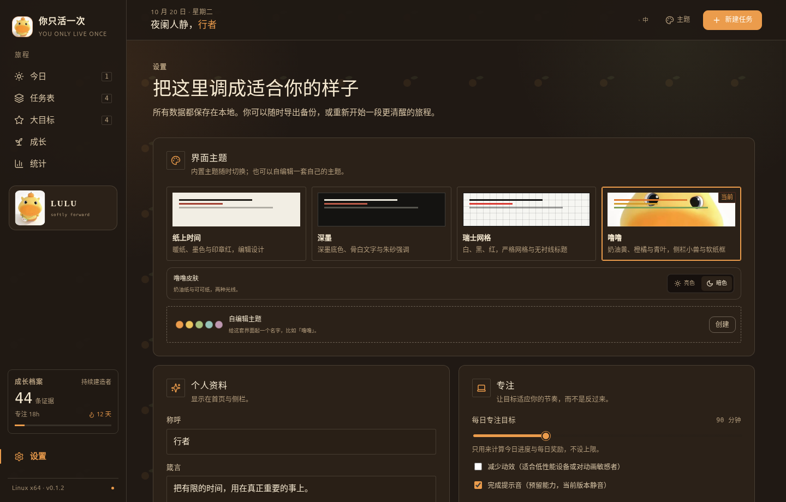

也支持在设置里自编辑一套主题：命名、选底子、调 9 个颜色；顶栏会一起循环。

## 快速开始

要求：Node.js ≥ 20.19、npm ≥ 10；Android 构建另需 JDK 21 与 Android SDK 35。

```bash
npm install

npm run dev          # Linux 开发模式
npm start            # Linux 生产构建并启动
npm run start:demo   # 载入示例数据启动
```

Windows：

```bash
npm run dev:windows
npm run start:windows
npm run start:demo:windows
```

Android：

```bash
npm run dev:android      # 移动 Web 预览
npm run build:android    # 构建 Web 资源
npm run sync:android     # 同步到 Capacitor 原生工程
npm run package:android  # 生成 debug APK（使用固定 debug keystore，可覆盖升级）
```

详细 Android 环境说明见 [`apps/android/README.md`](apps/android/README.md)。

### 手机端信息层级

- 顶栏压缩到 50px，只保留日期问候、主题、语言、设置和新建任务图标；Android 15+ 会自动避开状态栏、摄像头和底部系统导航。
- 今日首页只保留「今日封面」；正在专注、今日任务、大目标、最近足迹和重复统计不再堆在首页，从底部导航进入对应功能查看。
- 成长页把「成长阶段」「里程碑」「全部证据」收进点按弹层，主页面只保留摘要与入口。
- 噜噜主题在手机端显示顶部小头像和角色卡片，不再只有背景。
- 统计页的 14 天柱状图在手机端改用放大的「日」标签，避免日期挤在一起看不清。

## 构建与打包

| 平台 | 命令 | 产物 |
| --- | --- | --- |
| Linux x64 | `npm run package:linux` | AppImage / deb |
| Linux arm64 | `npm run package:linux:arm64` | AppImage / deb |
| Windows x64 | `npm run package:windows` | 便携版 ZIP |
| Windows arm64 | `npm run package:windows:portable:arm64` | 便携版 ZIP |
| Windows 安装器 | `npm run package:windows:installer` | NSIS，需要 Windows 或 Wine |
| Android | `npm run package:android` | Universal Debug APK |

产物默认在 `apps/<platform>/release/`；SHA256 见 [`SHA256SUMS.txt`](SHA256SUMS.txt)。

## 验证

```bash
npm run verify                 # typecheck + core 测试 + 全平台构建
npm run test:ui                # 真实 Electron 交互回归
npm run test:ai                # 本地 mock：访谈、计划评估、Key 隐私
npm run test:language          # 四语切换与重启保留
npm run test:themes            # 四主题、噜噜亮暗、设置面板
npm run test:theme-editor      # 自编辑主题
npm run test:rewards           # 奖励去重与证据链
npm run test:mobile            # 390×844 移动布局
npm run screenshots            # 逐页截图验收
```

当前核心测试：**45 个**。重点覆盖报告门禁、单计时、任务链、学习文档、写作计时、成长奖励、主题/皮肤、多语言、导入导出与重启恢复。

## AI 学习助理（可选）

- 默认关闭；只有启用并点击评估时才请求。
- 支持 OpenAI-compatible 接口：OpenAI、DeepSeek、Moonshot、Ollama、自定义地址。
- DeepSeek 推荐 `https://api.deepseek.com` + `deepseek-flash`；评估时自动关闭 thinking，避免推理占满输出。
- 先做多轮背景访谈，每轮只问一个问题；每题给 3 个候选回答 + 1 个自定义入口，减少打字。
- 访谈轮数不固定：可能 1 轮就够，也可能超过 6 轮，最多 10 轮；问题按置信度缺口动态生成，不刷固定题库。
- 置信度由 level / goal / baseline / scope / blocker / success 六个维度覆盖度、回答质量和模型判断共同计算；核心维度不全时不会被模型主观自信绕过。
- 反复低质量回答或达到上限仍不足时，不再无限追问，直接给出一份完整基础学习计划。
- 计划同时保留完整路径和“时间不足时的关键路径”：例如任务需要 20 小时，你只有 4 小时，会保留 20 小时全貌，再列出 4 小时最关键的部分和取舍。
- 可只凭当前任务和访谈答案重新生成计划，不重新问问题；重新开始访谈或重新生成计划前都会弹窗说明后果并确认。
- 学习计划可导出为 Markdown 文件（Linux/Windows 可直接保存，Android 走系统分享）。
- 用户明确说“新手/零基础”后会锁定 beginner 水平，后续只问入门问题，不再追问推导过什么、做过哪些项目。
- 用户先写自己的计划，AI 只评估，不代写、不出练习题、不自动改数据。
- 置信度只作为内部门槛，不在界面展示。
- 学习文档和写作记录默认允许发送，可在设置中关闭；API Key 不进入导出数据，桌面用 safeStorage，Android 用 Keystore。

## 数据与隐私

```text
Linux:   $XDG_CONFIG_HOME/yolo-linux/yolo-data.json
Windows: %APPDATA%\yolo-windows\yolo-data.json
Android: Capacitor Preferences（yolo-data-v1）
```

桌面端保存前写 `yolo-data.backup.json`；各端 JSON 模型一致，可互相导入。数据只在本机，没有后端、账号、云同步或埋点。

## 项目结构

```text
packages/core/         纯 TS 领域核心：任务、报告、计时、奖励、统计、主题类型
packages/desktop-ui/   共享界面、zustand 状态机、AI 客户端、i18n、皮肤资产
apps/linux/            Electron Linux 外壳
apps/windows/          Electron Windows 外壳
apps/android/          Capacitor Android 外壳与移动桥
scripts/               截图、交互回归、打包校验
docs/                  架构与路线
screenshots/           验收截图
```

更多实现细节见 [`docs/architecture.md`](docs/architecture.md)。

## 当前状态与限制

- Linux x64 / arm64：已构建 AppImage / deb。
- Windows x64 / arm64：便携版已构建，尚未在真实 Windows 机器上验收 DPI、IME 与睡眠恢复；未代码签名。
- Android：Universal Debug APK；使用仓库内固定 debug keystore，连续版本可覆盖安装，但这不是上架签名；上架需 release keystore。
- macOS / iOS 支持已在 v0.2.0 取消；仓库不再包含对应工程、构建任务与发布产物。
- 完成提示音为预留开关，当前版本静音。
- 数据为单 JSON / Preferences，v1 未加密；敏感信息不要写进报告。


## 自动更新

从 **v0.1.9** 开始，客户端启动后会自动检查 GitHub Releases：

- 发现新版本时弹出提示，可选择「下载并更新」「稍后」或「跳过这个版本」
- Windows 便携版：下载 ZIP、校验 SHA-256、退出后自动替换并重启
- Linux AppImage：下载新 AppImage 后自动替换并重启
- Android：打开新版 APK 下载，覆盖安装即可保留数据
- 更新包都会校验 GitHub Release 提供的 SHA-256

注意：**v0.1.9 之前的版本本身没有更新检查器**，需要最后手动安装一次 v0.1.9；从 v0.1.9 开始后续版本都能收到更新提示。

## 发布 Release

推荐用 tag 触发 `.github/workflows/release.yml`：

```bash
git tag -a v0.2.0 -m "YOLO v0.2.0"
git push origin v0.2.0
```

Actions 会并行构建 Linux、Windows、Android，并把以下文件挂到 GitHub Release：

```text
Linux x64 / arm64:   AppImage + deb
Windows x64 / arm64: portable ZIP
Android:             universal debug APK
SHA256SUMS.txt
```

如果暂时不想配置 Actions，也可以在本机打包后，打开：
**GitHub → Releases → Draft a new release → 选择 tag → 手动上传以上产物 → Publish release**。

发布新版本时，记得同步修改 `package.json`、各子包版本号、Android `build.gradle` 的 `versionName`，再创建新的 tag。

> 代码采用 MIT License；噜噜人物、应用图标等品牌素材不包含在 MIT 授权中，详见 [`LICENSE-ARTWORK`](LICENSE-ARTWORK)。

## License

- **代码**：MIT，见 [`LICENSE`](LICENSE)。
- **噜噜人物、应用图标、启动图等品牌素材**：版权保留，见 [`LICENSE-ARTWORK`](LICENSE-ARTWORK)。可以随本应用的完整构建/发行版一起使用，但不能单独提取、转售或再分发。

第三方依赖保留各自许可证。

